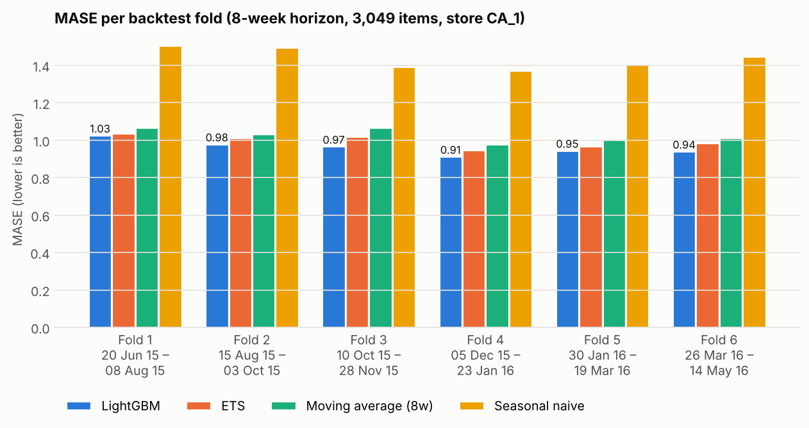
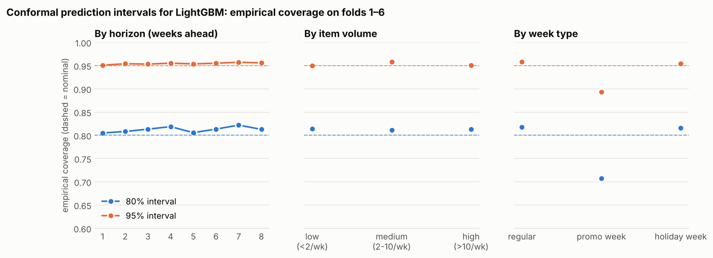
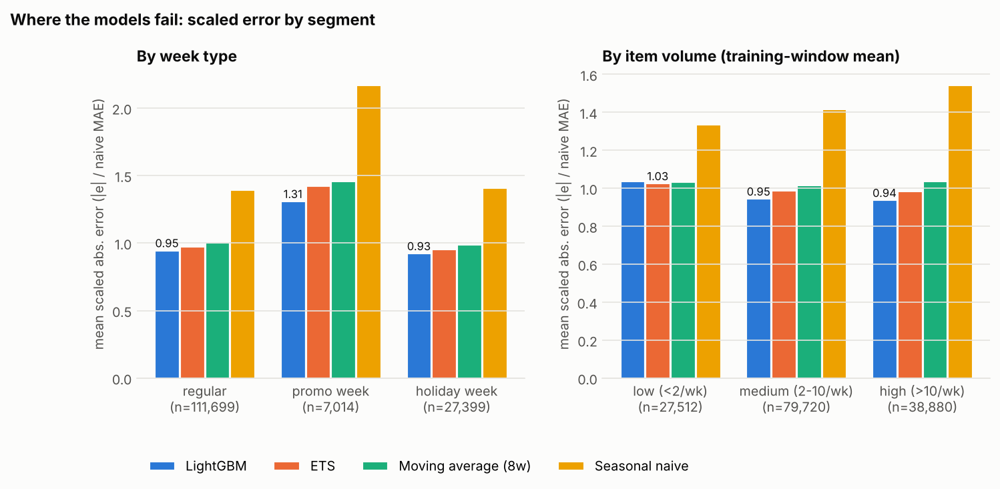
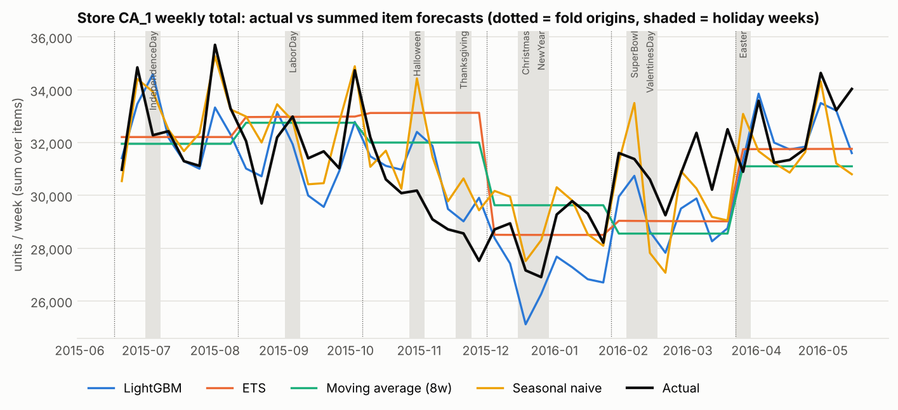

# Weekly demand forecasting on M5 (Walmart), with leakage-safe backtesting

[](https://github.com/kadaru242003/demand-forecasting-backtest/actions/workflows/ci.yml)

This project forecasts **weekly unit sales for each of the 3,049 products in one Walmart store** for the
next 8 weeks. It compares a seasonal naive baseline, a moving average, per-series exponential smoothing
(ETS) and a global LightGBM model, all under one rolling-origin backtest. LightGBM also gets
conformal prediction intervals, and the error analysis covers holidays, price promotions and
low-volume items.

**Short version:** LightGBM is the most accurate model at the item level. It cuts MAE by 37% compared
with seasonal naive, and by about 5% compared with ETS. It wins in all 6 backtest folds and for 64% of
items. The gains over the simple models are modest, though. When item forecasts are summed to a store
total, seasonal naive is about as accurate as LightGBM, and LightGBM under-forecasts the Christmas
period. Promotion weeks are where every model fails most.

## Contents

- [Dataset](#dataset)
- [Forecasting target](#forecasting-target)
- [Models](#models)
- [Validation design](#validation-design)
- [Results](#results)
- [Prediction intervals](#prediction-intervals)
- [Error analysis](#error-analysis)
- [Limitations](#limitations)
- [Reproducing](#reproducing)

## Dataset

**M5 forecasting competition data** (Makridakis, Spiliotis & Assimakopoulos, 2022). It contains daily
unit sales of 3,049 Walmart products in 10 stores (CA, TX, WI) from 2011-01-29 to 2016-05-22, plus a
calendar of events and SNAP (food-stamp) days and the weekly sell price of every item in every store.

**Why M5:**

- It is real retail point-of-sale data at the level where replenishment decisions are made (item × store).
- It contains exactly what the error analysis needs: dated holidays and events, price changes that
  can stand in for promotions, and a long tail of slow-moving items.
- It is a well-known benchmark, so results can be compared with published work.
- I checked access from this environment first. Kaggle, UCI and Zenodo are blocked by the network
  policy, but a public mirror of the original files on GitHub is reachable
  (`raw.githubusercontent.com/Nixtla/m5-forecasts`). Other candidates I considered, Walmart
  Store Sales, Rossmann and Favorita, are distributed through Kaggle.

`src/demand_forecast/data.py` downloads the 50 MB archive and checks its SHA-256 checksum. The raw
data is **not** committed (`data/` is git-ignored). The M5 data comes from a Kaggle competition, and
this repository uses it for non-commercial, educational analysis only.

### Cleaning (`build_weekly_panel`)

| Step | What and why |
|---|---|
| Daily → weekly | Daily sales are summed into Walmart weeks (Saturday to Friday, `wm_yr_wk`). The last, partial week is dropped, leaving 277 complete weeks (2011-01-29 to 2016-05-20). |
| Launch trimming | Each item's history starts at its first week with a sell price. M5 pads not-yet-launched items with zeros, which would look like real zero demand. |
| Off-shelf weeks | Weeks after launch with no price are flagged and the last price is carried forward. CA_1 has none. |
| Holiday flags | Ten major events (Super Bowl, Valentine's, Easter, Memorial Day, Independence Day, Labor Day, Halloween, Thanksgiving, Christmas, New Year) are flagged on the week that contains them, together with a flag for the week before a holiday. |
| Promotion proxy | M5 has no promotion field. A week counts as a **promo week** when the price is at least 5% below the item's highest price over the previous 52 weeks. This applies to 7.1% of item-weeks. |

After cleaning, store **CA_1** has 683,167 item-weeks. 21% of them have zero sales, and 29% of items
average fewer than 3 units a week, so many series are intermittent.

## Forecasting target

`sales`: **units sold of one item in store CA_1 in one Walmart week**, forecast **1 to 8 weeks ahead**
from each forecast origin.

- *Weekly* is the cadence of store replenishment and of M5's price data. It also removes day-of-week
  noise.
- *Item × store* is the level at which orders are placed. It is much harder than forecasting
  aggregates, which is why results are also reported for the summed store total.
- *One store* keeps the full backtest at about 15 minutes on 4 CPU cores. The code takes `--store`
  for any of the 10 stores.

## Models

| Model | Description |
|---|---|
| Seasonal naive | Sales in the same week one year (52 weeks) earlier. Items with less than a year of history fall back to the last value. |
| Moving average (8w) | Mean of the last 8 weeks, flat over the horizon. A strong simple benchmark for noisy item data. |
| ETS | Per-item exponential smoothing (statsmodels `ETSModel`). It picks ETS(A,N,N) or damped-trend ETS(A,Ad,N) by AICc. There is no 52-week seasonal component, because estimating 52 seasonal states per noisy item overfits. |
| LightGBM | One global model across all items, with one booster per horizon (direct strategy) and a Tweedie loss for zero-heavy counts. Features: sales lags and rolling means/std/zero share **anchored at the forecast origin**, sales from one year earlier, week-of-year and month, holiday flags, SNAP days, price, discount and promo flag, and department and category. Hyperparameters were fixed in advance and **not tuned on the backtest**. Training uses the last 156 weeks before each origin. |

## Validation design

**Rolling-origin (expanding-window) backtest.** There are six evaluation folds, each with an 8-week
test window. Together the windows cover the last 48 weeks of data (2015-06-20 to 2016-05-14), so
Independence Day, Labor Day, Halloween, Thanksgiving, Christmas, New Year, the Super Bowl and Easter all
fall inside a test window. An earlier fold 0 (test window 2015-04-25 to 2015-06-13) is used only to
calibrate the prediction intervals for fold 1.

| Fold | Train ends | Test window |
|---|---|---|
| 1 | 2015-06-13 | 2015-06-20 to 2015-08-08 |
| 2 | 2015-08-08 | 2015-08-15 to 2015-10-03 |
| 3 | 2015-10-03 | 2015-10-10 to 2015-11-28 |
| 4 | 2015-11-28 | 2015-12-05 to 2016-01-23 |
| 5 | 2016-01-23 | 2016-01-30 to 2016-03-19 |
| 6 | 2016-03-19 | 2016-03-26 to 2016-05-14 |

**How leakage is prevented** (`backtest.py`):

- `fit` receives only rows up to the origin.
- `predict` receives the test rows with the **target column removed**.
- Only items that already exist at the origin are forecast.
- LightGBM's sales features for horizon *h* are computed from data up to *t − h*.

These properties are tested in `tests/test_backtest.py`:

- the folds tile the data with no overlap;
- models never receive future targets (checked with a spy model);
- the features for horizon *h* are identical when every sales value after *t − h* is deleted;
- **every model's forecasts stay exactly the same when all sales after the origin are replaced
  with random numbers**.

I also checked the tests themselves. Moving the cutoff forward by one week makes 5 of the leakage tests
fail.

**What counts as known in advance.** Calendar features and **sell prices of the target week** are used
as known future inputs, because a retailer sets its own prices and promotions ahead of time. M5 also
provides future prices. See the limitations section.

**Metrics:**

- **MAE** and **RMSE** are computed in units across all item-weeks.
- **MASE** is each item's MAE divided by the in-sample MAE of the one-step naive forecast on that
  fold's training window (Hyndman & Koehler, 2006), averaged over items. Items with constant
  history are excluded. MASE < 1 means the 1–8-week-ahead forecast beats the in-sample one-step
  naive forecast.
- **MAE vs seasonal naive** compares each model with the baseline directly.

## Results

All numbers are means over the 6 evaluation folds. The full tables are in
[`reports/results.md`](reports/results.md) and the CSVs in `reports/`.

| Model | MAE | RMSE | MASE | MASE range across folds | MAE vs seasonal naive | Folds better than seasonal naive |
|---|---|---|---|---|---|---|
| **LightGBM** | **4.13** | **9.04** | **0.963** | 0.914 – 1.027 | **0.63** | 6/6 |
| ETS | 4.33 | 10.04 | 0.996 | 0.949 – 1.038 | 0.66 | 6/6 |
| Moving average (8w) | 4.56 | 10.96 | 1.027 | 0.978 – 1.067 | 0.70 | 6/6 |
| Seasonal naive | 6.53 | 14.61 | 1.437 | 1.373 – 1.506 | 1.00 | – |

MASE per fold:

| Fold | LightGBM | ETS | Moving average (8w) | Seasonal naive |
|---|---|---|---|---|
| 1 (Jun–Aug 2015) | 1.027 | 1.038 | 1.066 | 1.506 |
| 2 (Aug–Oct 2015) | 0.980 | 1.013 | 1.033 | 1.495 |
| 3 (Oct–Nov 2015) | 0.968 | 1.019 | 1.067 | 1.393 |
| 4 (Dec 2015–Jan 2016) | 0.914 | 0.949 | 0.978 | 1.373 |
| 5 (Jan–Mar 2016) | 0.946 | 0.969 | 1.004 | 1.406 |
| 6 (Mar–May 2016) | 0.941 | 0.985 | 1.013 | 1.448 |



**How to read these numbers:**

- **Seasonal naive is a weak baseline at item level.** One item's sales in a single week last year
  is mostly noise, so every other model beats it by 30–37% in MAE.
- **The gap between the models that beat it is small.** LightGBM beats ETS in every fold, but by
  only 1–5% in MASE. It has a lower MAE than ETS for 64% of items, so 36% of items are forecast
  better by per-item ETS. Its largest edge is in RMSE (−10% vs ETS), which means it mostly avoids
  large misses rather than improving typical weeks.
- **MASE stays close to 1.** Even the best model is only a little better at 1–8 weeks ahead than a
  one-step naive forecast is in-sample. That is typical for intermittent item-level retail data,
  not a sign of a broken model.
- Six folds from one store are not enough to claim that LightGBM's edge over ETS is statistically
  significant or holds in other stores.

## Prediction intervals

The best model (LightGBM) gets **80% and 95% intervals from scaled split-conformal calibration**
(`intervals.py`):

1. Collect residuals from earlier folds whose test windows ended at or before the current origin.
2. Divide each residual by its item's naive-MAE scale.
3. Take the empirical lower and upper quantiles for each horizon. Using both quantiles allows
   asymmetric intervals.
4. Map the quantiles back with each item's scale.

Calibration never uses the fold being evaluated, which is tested.

| Nominal | Empirical coverage (folds 1–6) | Coverage range across folds | Mean width (units) |
|---|---|---|---|
| 80% | **81.2%** | 80.4% – 82.7% | 12.8 |
| 95% | **95.4%** | 94.6% – 96.2% | 21.6 |



Coverage is close to nominal across horizons and volume segments. It is **only marginal**, though:
**in promotion weeks the 80% interval covers just 70.7% and the 95% interval 89.3%**, because the
model under-forecasts promotional uplift and the calibration pool is mostly non-promo weeks. For
low-volume items, coverage is helped by the many zero-sales weeks, which fall inside almost any
interval clipped at zero.

## Error analysis

Errors are compared across segments using the **scaled absolute error** (|error| / item's naive MAE),
so fast and slow movers carry equal weight.



### Promotions: the clearest failure (all models)

| | LightGBM | ETS | Moving average | Seasonal naive |
|---|---|---|---|---|
| Scaled error, regular weeks | 0.95 | 0.98 | 1.01 | 1.40 |
| Scaled error, promo weeks | **1.31** | 1.43 | 1.46 | 2.17 |
| Bias in promo weeks (Σforecast/Σactual − 1) | −3.6% | −11.8% | −15.7% | −40.7% |

- Scaled errors are about 40% higher in the 7,014 promo item-weeks for every model.
- The time-series models cannot know about a price cut, so they under-forecast the uplift by
  12–16%.
- LightGBM uses the planned price and removes most of the *bias*, but its errors are still much
  larger than in regular weeks.
- The promo flag is only a proxy (a price drop), and many promotions in the data are short or
  shallow.

### Holidays: fine at item level, a problem at store level

- **At item level, holiday weeks are not harder than regular weeks** (scaled error 0.93 vs 0.95 for
  LightGBM). Item-level noise is much larger than the holiday effect.
- **The worst holiday week is Thanksgiving** (scaled error 1.00 for LightGBM and 1.11 for ETS, against
  0.95 and 0.98 in regular weeks).
- **The problem shows up at store level.** The chart below sums item forecasts to the store total:



| Store weekly total | LightGBM | ETS | Moving average | Seasonal naive |
|---|---|---|---|---|
| MAPE, mean over folds | 4.1% | 5.7% | 5.6% | **3.9%** |
| Bias in fold 4 (Dec 5 – Jan 23) | **−5.5%** | −0.1% | +3.8% | +1.9% |
| Bias in fold 3 (Oct 10 – Nov 28) | +3.9% | +11.8% | +8.0% | +5.0% |

- **Seasonal naive is the best model for the store total** even though it is by far the worst
  for items. The yearly pattern (an autumn decline and a December/January dip) is real in
  aggregate but buried in noise for individual items.
- **LightGBM under-forecast the whole Christmas-to-January fold by 5.5%.** The miss is −7.5% in the
  week of Christmas Day (when the store is closed one day) and grows to −8.4% in mid-January. The
  model seems to carry the holiday dip forward for too long.
- **ETS and the moving average are flat**, so they cannot follow the autumn decline and
  over-forecast fold 3 by 8–12%.
- For decisions at store or distribution-centre level, item-level accuracy alone is the wrong
  selection criterion. A hierarchical or reconciled approach would be the next step.

### Low-volume items: no model helps much

| Item volume (training-window mean) | LightGBM | ETS | Moving average | Seasonal naive |
|---|---|---|---|---|
| low (< 2 units/week), 19% of rows | 1.040 | **1.028** | 1.036 | 1.337 |
| medium (2–10) | **0.947** | 0.989 | 1.017 | 1.418 |
| high (> 10) | **0.940** | 0.986 | 1.041 | 1.547 |

- For slow movers, **LightGBM is slightly worse than ETS** and over-forecasts by 4.2% in total.
  For items that sell 0–2 units a week, a smoothed level is about the best any of these models can
  do.
- LightGBM's whole advantage comes from medium- and high-volume items.
- Intermittent-demand methods (Croston/TSB) and evaluating the forecast quantile that drives the
  order quantity would suit slow movers better than point MAE.

### When accuracy changes

Errors grow with horizon for every model except seasonal naive, whose error does not depend on
horizon. LightGBM's MAE goes from 3.44 at 1 week ahead to 4.64 at 8 weeks ahead, and ETS's from 3.60
to 4.94. Fold 1 (summer 2015) is the hardest fold for LightGBM, ETS and seasonal naive.

## Limitations

- **One store, one period.** All results are for store CA_1 and a single 48-week evaluation
  period. Other stores and states (TX, WI, which have different SNAP schedules) may rank the models
  differently. The gaps between LightGBM, ETS and the moving average (3–6% in mean MASE) are small enough
  that this matters.
- **Known future prices.** LightGBM uses the target week's sell price and the promo proxy derived
  from it. This is realistic only if prices and promotions are fixed at least 8 weeks ahead. If they
  are not, LightGBM's promo-week advantage is overstated.
- **Promotion proxy.** M5 has no promotion field, so "promo week" means a price at least 5% below the
  previous 52-week maximum. Display, feature and advertising promotions are not visible.
- **Hyperparameters were not tuned.** This avoids overfitting the backtest. A tuned LightGBM (with
  nested validation) would probably do a little better, and so might a seasonal ETS on aggregated
  data.
- **No cold start.** Items launched after an origin are not forecast in that fold.
- **Marginal intervals.** Conformal coverage holds on average, not for every segment: promo weeks
  are under-covered. Intervals are per item-week and cannot be summed to store-level intervals.
- **MASE details.** The MASE scale is the in-sample one-step naive MAE. Averaging per-item ratios
  gives a lot of weight to very low-scale items, so MAE and RMSE are reported alongside.
- **Store total is bottom-up only.** No reconciliation or dedicated aggregate model was tried, so
  the store-level comparison is a diagnostic rather than an optimised result.
- **Holiday-week definition.** Christmas Day falls in the Walmart week of Dec 19–25, and holiday
  flags mark only the week containing the event day. Effects spread across neighbouring weeks
  (for example Black Friday right after Thanksgiving) are only partly captured.

## Reproducing

```bash
pip install -e ".[dev]"
pytest                                          # about 10 s, synthetic data, no download
python -m demand_forecast.pipeline --store CA_1 # full backtest, about 15 min on 4 cores
jupyter lab notebooks/walkthrough.ipynb         # short walkthrough (runs a small backtest)
```

The pipeline writes `reports/*.csv`, `reports/results.md` and `reports/figures/*.png`. Forecasts are
cached in `data/processed/`. `--reuse` re-plots without refitting.

```text
src/demand_forecast/
  data.py        download, checksum, cleaning, weekly panel
  backtest.py    folds, the leakage-safe split, backtest runner
  features.py    origin-anchored lag/rolling features + known-ahead covariates
  models.py      SeasonalNaive, MovingAverage, ETS, LightGBMDirect
  metrics.py     MAE, RMSE, MASE, coverage, interval score
  intervals.py   scaled split-conformal intervals from earlier folds
  evaluation.py  per-fold metrics, segment errors, bias, coverage reports
  plots.py       the four README charts
  pipeline.py    end-to-end CLI
tests/           data cleaning, models, metrics, intervals, and the leakage tests
notebooks/       walkthrough.ipynb
```

CI (GitHub Actions) runs ruff and pytest on Python 3.11 and 3.12, then executes the notebook on the
real data.

### References

- Makridakis, S., Spiliotis, E., & Assimakopoulos, V. (2022). M5 accuracy competition: Results,
  findings, and conclusions. *International Journal of Forecasting*, 38(4).
- Hyndman, R. J., & Koehler, A. B. (2006). Another look at measures of forecast accuracy.
  *International Journal of Forecasting*, 22(4).
- Romano, Y., Patterson, E., & Candès, E. (2019). Conformalized quantile regression. *NeurIPS*,
  and the split-conformal literature that the scaled-residual intervals follow.
